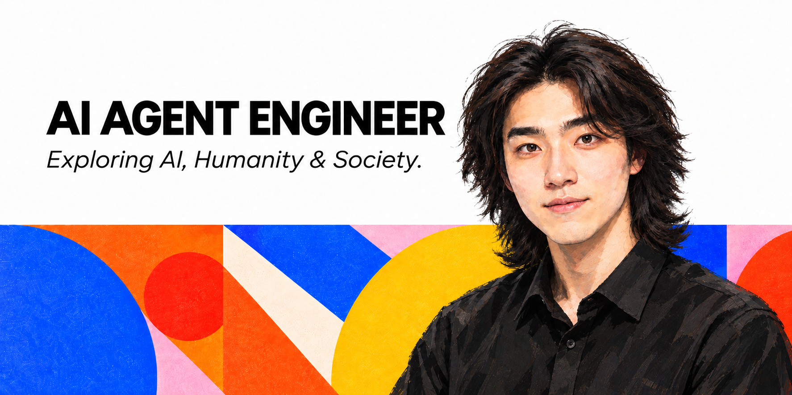

  

# Hi there 👋

### **About This Repository**

This GitHub is my personal playground for exploring **AI Agents**, **multimodal AI**, and **software engineering**.

Projects here are experimental **Proofs of Concept (PoCs)**, **Minimum Viable Products (MVPs)**, or lightweight technical prototypes.

These projects focus on **validating technical ideas** and exploring the **feasibility of emerging technologies** through hands-on implementation —— *not necessarily for production use.*
<!--

They're built primarily for learning, validating ideas, and experimenting with new technologies 
**BOCEAN-FENG/BOCEAN-FENG** is a ✨ _special_ ✨ repository because its `README.md` (this file) appears on your GitHub profile.

Here are some ideas to get you started:

- 🔭 I’m currently working on ...
- 🌱 I’m currently learning ...
- 👯 I’m looking to collaborate on ...
- 🤔 I’m looking for help with ...
- 💬 Ask me about ...
- 📫 How to reach me: ...
- 😄 Pronouns: ...
- ⚡ Fun fact: ...
-->
